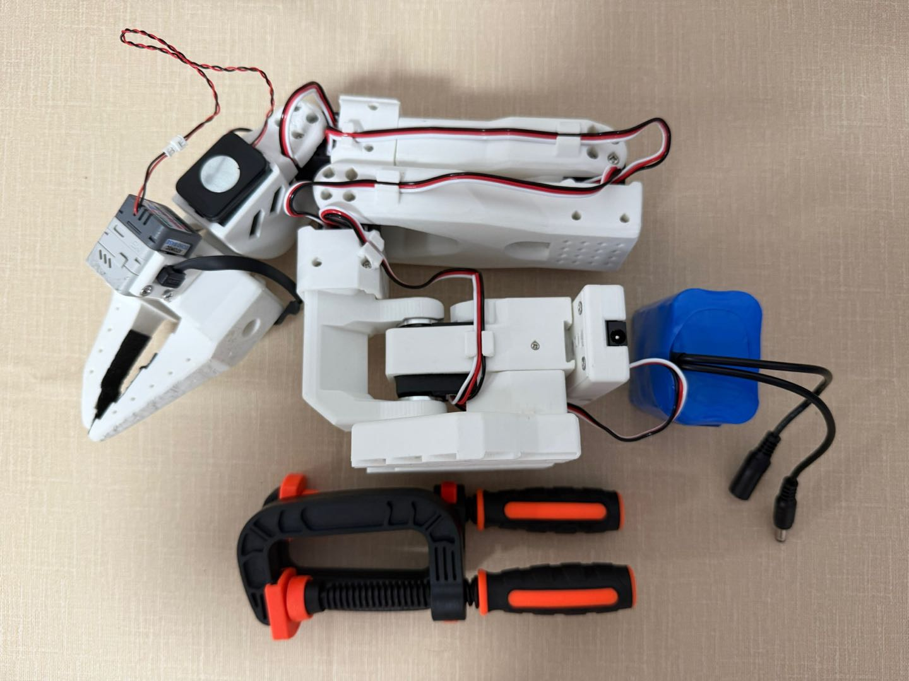
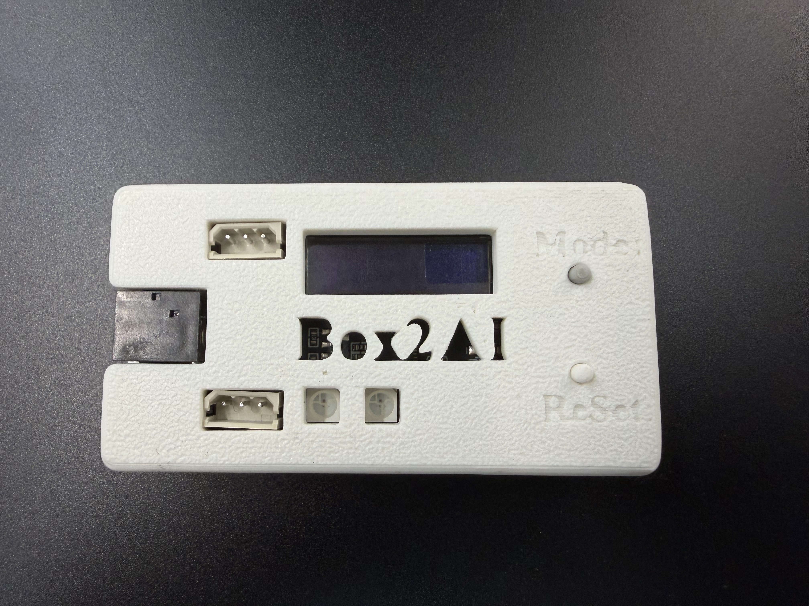
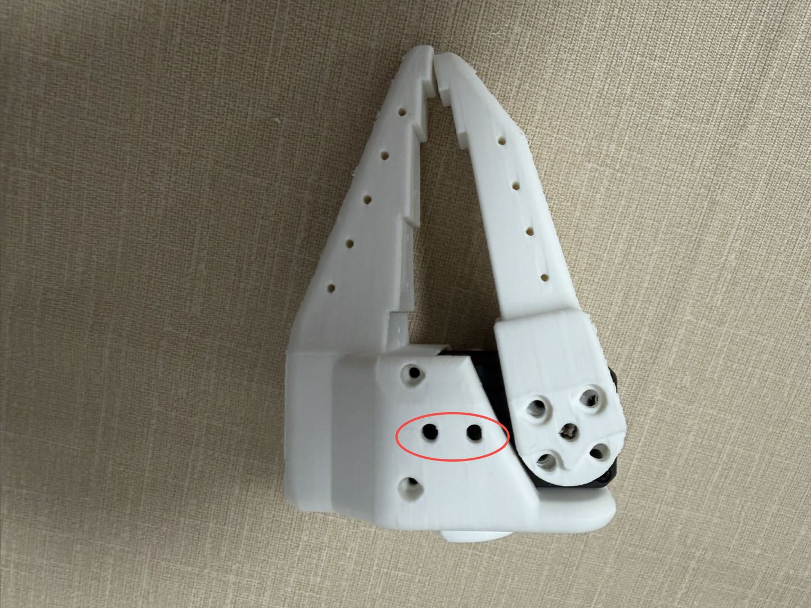
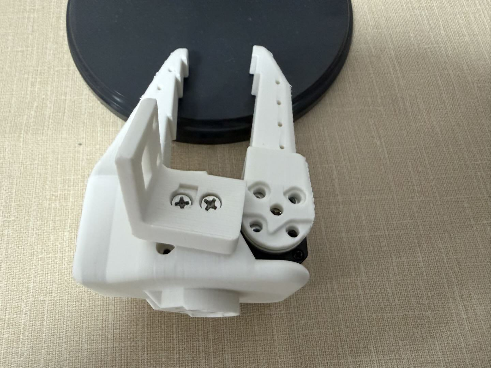
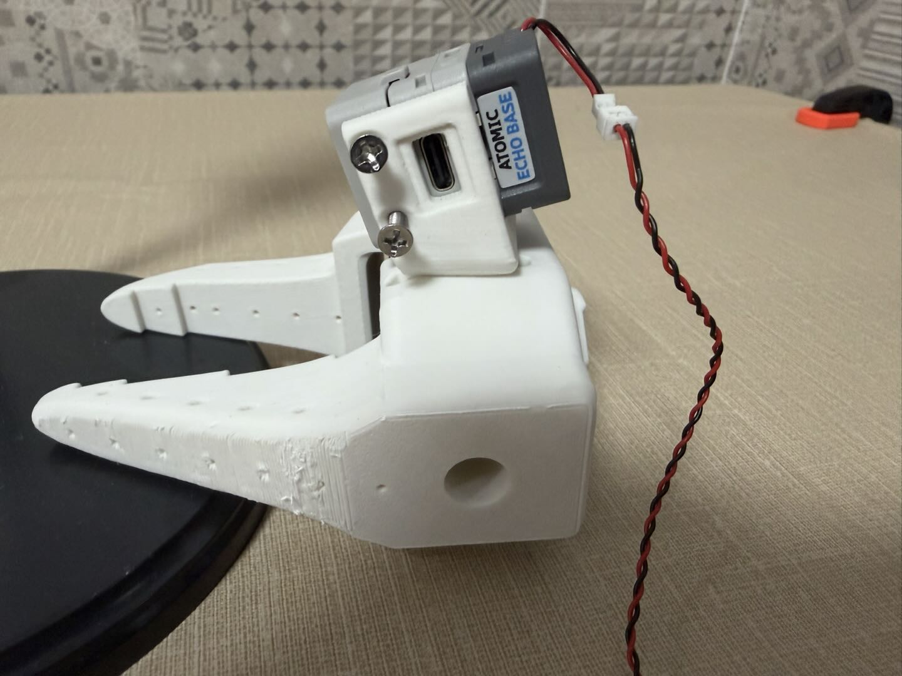
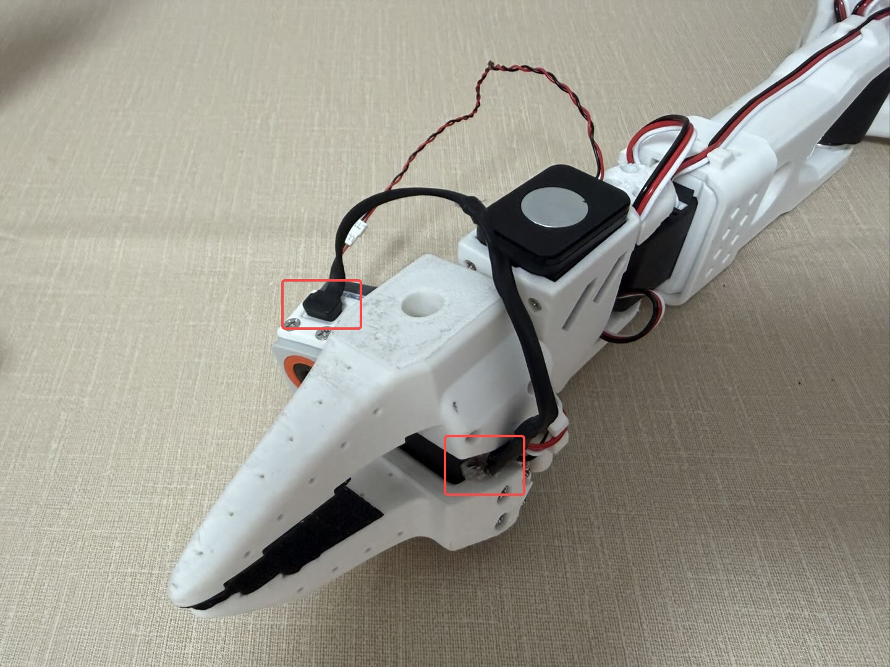
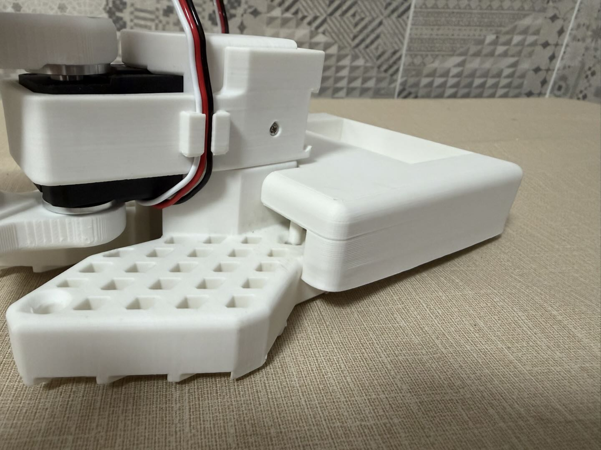
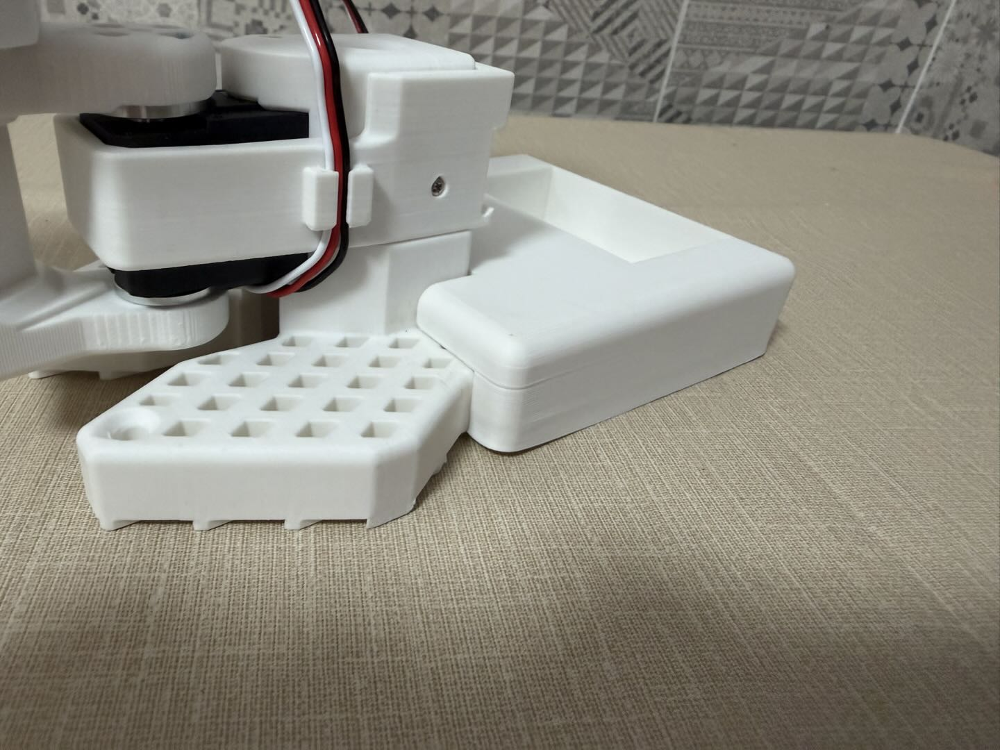
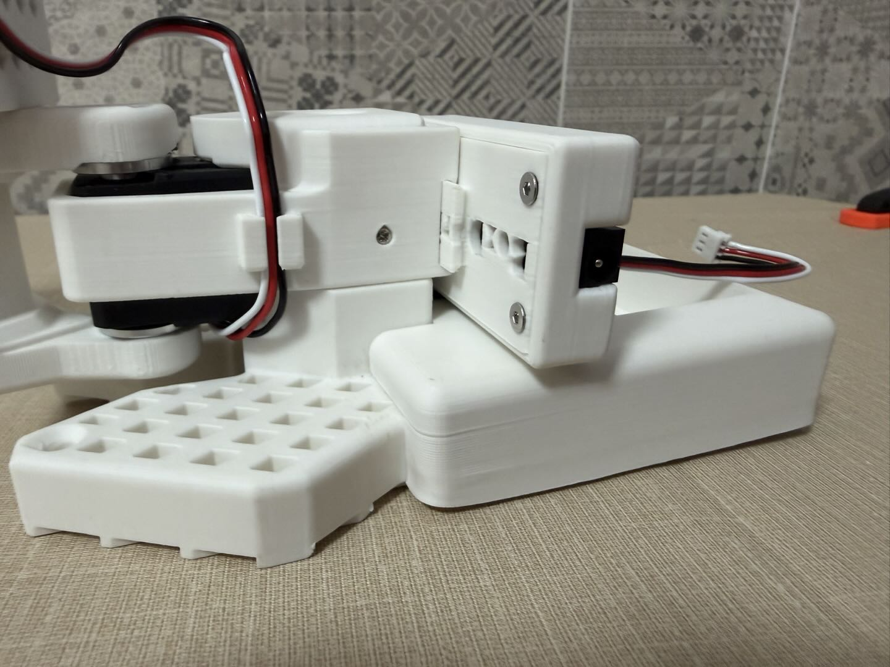
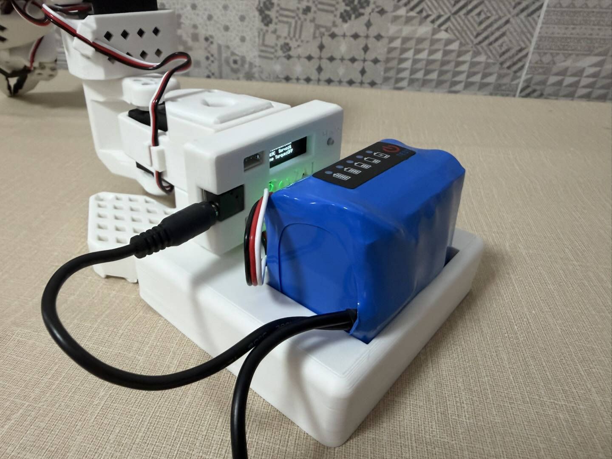

[English](README_en.md) | 中文

# Box2Robot — 具身智能云平台

**即插即用的机械臂，云端训练、技能共享、AI 智能体控制。**

<div align="center">
  
</div>

Box2Robot 是一个开源具身智能平台。将 ESP32 机械臂和视觉模块连接到云端平台，实现数据采集、模型训练和技能共享。无需复杂配置 —— 烧录固件、连 WiFi、绑定设备，即可开始。

> **当前固件包：ARM v0.7.2 / CAM v0.7.1**（机械臂固件 v0.7.2 / 摄像头固件 v0.7.1，均已编译、打包并发布 OTA；设备端升级与力矩保护仍待实机验证）

## 快速开始

### 1. 获取硬件

<div align="center">
  <a href="https://item.taobao.com/item.htm?abbucket=5&id=1030962099420">
    
  </a>
  <br>
  <a href="https://item.taobao.com/item.htm?abbucket=5&id=1030962099420">购买 Box2AI 机械臂套件 (淘宝)</a>
</div>

组装机械臂并将舵机连接到驱动板。固件已预装，如需手动烧录请参阅 [烧录固件](#烧录固件)。

### 摄像头模块安装

<div align="center">
  
  
  
</div>

<div align="center">
  
  
</div>

### 电池托盘与驱动器安装

<div align="center">
  
  
</div>

<div align="center">
  
  
</div>

> **驱动板与摄像头是两台独立设备，必须分别连接 WiFi、分别绑定到同一账号。** 完成驱动板配置后，再连接摄像头热点重复配网与绑定。两者同为 `192.168.4.1`，但访问的是当前热点对应的设备。
> [完整使用手册（无需登录）](https://robot.box2ai.com/#/pages/developer/docs?section=connect) · [新版固件、烧录与力矩保护指令](bin/README.md)

### 2. 连接设备热点

给设备上电，设备会创建 WiFi 热点：
- **机械臂驱动板：** `Box2Robot_XXXX` (XXXX 为 MAC 后 4 位)
- **视觉语音模块：** `Box2Cam_XXXX`

用手机或电脑连接该热点。会自动弹出配网页面（如未弹出，手动访问 `192.168.4.1`）。

### 3. 配置 WiFi

在配网页面输入 2.4 GHz WiFi 名称和密码。设备会保存凭据、重启并连接到你的网络。页面可切换中英文；重新扫描时按钮显示 `Scanning`，旧列表仍可选择，成功后再刷新。

### 4. 绑定设备

设备连上 WiFi 后，获取 **6 位绑定码**：
- **机械臂：** 显示在 OLED 屏幕上
- **摄像头：** 通过 TTS 语音播报

然后：
1. 访问 [**https://robot.box2ai.com**](https://robot.box2ai.com/#/)
2. 注册账号
3. 进入 **设备管理 → 绑定设备**
4. 输入 6 位绑定码
5. 完成！

绑定后即可使用全部功能：远程遥控、校准、数据采集、云端训练、技能商店、语音交互。

### 5. 按键操作

驱动盒上的灰色按钮支持以下操作：

| 操作 | 功能 |
|------|------|
| **单击** | 取消力矩 — 释放所有舵机，可自由拖动机械臂 |
| **长按 (3秒以上)** | 重置出厂设置 — 清除已保存的 WiFi 信息，设备重启后重新进入热点配网模式 |

---

## AI 智能体控制 (Skills CLI)

从 [Skills 分步使用说明](box2robot_skills/README.md) 开始：获取 API Key → 安装 CLI → 指定机械臂 → 查询状态 → 小幅动作 → 相机采集、训练推理与技能商店。

1. 登录 [工作台](https://robot.box2ai.com)，绑定设备并确认在线与校准。
2. 账户 / 个人中心 → [API 密钥](https://robot.box2ai.com/#/pages/profile/api-keys) → “＋ 生成新密钥”。填写名称，选择权限，生成后复制并保存完整 Key（只显示一次）。基础控制选择 `device`，其他功能按需增加权限。
3. 获取 [ClawHub 技能包](https://clawhub.ai/boxjod/box2robot-skills)，或克隆本仓库进入 `box2robot_skills`，安装依赖：

```bash
python -m pip install "aiohttp>=3.9,<4"
python b2r.py --help
# 按分步说明设置 B2R_API_KEY 和 B2R_DEVICE 后：
python b2r.py devices
python b2r.py status
```

4. 对照实时位置和关节限位，在人工看护下执行明确的小幅动作。完整 PowerShell / Bash 示例见 [使用说明](box2robot_skills/README.md)。API 返回已下发不等于动作已完成。
5. 教程覆盖实时相机帧、带图像录制、数据集下载、视频生成、ACT 训练推理和商店技能，并介绍 Code as Policy、上下文技能、个人技能仓库与姿态记忆的网页入口。

让智能体先读取 [SKILL.md](box2robot_skills/SKILL.md)，再按任务查阅 [SKILLS.md](box2robot_skills/SKILLS.md)。例如：“先查询我指定机械臂的状态，不发送运动；确认后再做一次小幅测试。”独立 `b2r.py` 不支持旧文档中的 `say`、`shell`、`exec`。

[网页开发文档：API 与 CLI](https://robot.box2ai.com/#/pages/developer/docs?section=api) · [Code as Policy](https://robot.box2ai.com/#/pages/developer/docs?section=code-policy)。平台 API Key 和模型供应商 API Key 用途不同；退出 CLI 不会吊销 Key，停用时到网页吊销。

---

## GPU 训练与推理节点（高级）

`box2robot_gpu_worker/` 是 GPU 算力节点，连接 Box2Robot 云端服务器，自动领取训练和推理任务。需要 **RTX 3060+ GPU**，支持 ACT (Action Chunking Transformer)、Diffusion Policy、MLP 等模型。

只需 3 步：安装 → 启动 → 在 APP 中输入绑定码。绑定后 Worker 自动轮询任务、下载数据集、训练模型、上报进度，所有操作均在 APP 端完成。

克隆仓库时**必须带上 `--recurse-submodules`** 拉取 LeRobot 子仓库：

```bash
git clone --recurse-submodules https://github.com/box2ai-robotics/box2robot.git
```

> 已 clone 但没拉 submodule？在仓库根目录执行 `git submodule update --init --recursive` 即可补上 LeRobot。

详见 [box2robot_gpu_worker/README.md](box2robot_gpu_worker/README.md)。

---

## 固件升级

设备出厂已预装最新固件，**推荐使用在线 OTA 升级**：

1. 设备绑定后进入 [https://robot.box2ai.com](https://robot.box2ai.com/#/) → **设备管理**
2. 在设备详情中点击 **固件升级**，云端会自动推送最新固件并完成升级

当前 OTA 版本为 **ARM v0.7.2 / CAM v0.7.1**，两个设备分别升级。正常 OTA 只写入应用固件，不执行整片擦除；升级前停止录制、推理和动作执行，支撑机械臂，并保持设备供电与网络稳定。版本接口、更新说明及两份固件的实际下载 SHA256 已核验；服务器发布成功不等于设备已升级。

**手动烧录**（适用于首次烧录空板、设备无法启动、需要刷写自编译固件等场景）：详见 [`bin/README.md`](bin/README.md)。

---

## 更新日志

| 版本 | 日期 | 说明 |
|------|------|------|
| v0.7.2 (arm) | 2026-10-10 | 滑块短路径扣除串口耗时并去重重复位置；逐关节原始负载阈值、固定 100 tick 领先量、等于阈值不触发；关闭保护恢复输出上限 1000；增加原始型号与输出限制回读。 |
| v0.7.1 (arm) | 2026-10-10 | 默认开启、持久保存的力矩保护开关；关闭取消负载限力与目标钳位，温度保护保留；配网页扫描保留旧列表、Scanning 状态与中英文切换 |
| v0.7.1 (cam) | 2026-10-12 | 修复恢复出厂、扫描后网页配网连接失败或超时；停止扫描、清理旧状态并主动连接，保留中英文页面及已保存网络回连 |
| v0.7.0 (cam) | 2026-10-10 | 配网页扫描期间保留可选择的旧列表，防重复扫描、超时恢复与中英文切换；沿用受信任 HTTPS OTA 校验 |
| v0.6.9 (cam) | 2026-10-07 | OTA 安全与可靠性更新：受信任 HTTPS 下载地址、禁止 HTTP 跳转、备用分区写入校验后切换启动、30 分钟总超时与 60 秒无进度退出、失败原因上报；提供固件、引导程序和分区表三个镜像，保留旧版本；设备端升级仍待实机验证 |
| v0.7.0 (arm) | 2026-10-07 | 新增六关节逐关节力矩保护：20 ms 周期（目标 50 Hz）的三采样负载检测、出厂差异化阈值（ID1~6：500/600/650/550/450/150，原始负载单位），支持手动回驱时降力矩让位、松手后按原目标缓慢回位；增加温度/堵转保护，并通过快速状态帧和 `servo_protection` 事件向 Server 实时上报负载、阈值、保护状态和触发原因 |
| v0.6.6 (arm) | 2026-05-04 | 修复录制中 WS 断连（transport_poll_write）：RAM 录制缓冲 1200→300 帧释放约 80KB BSS，heap 从 30KB 恢复至约 110KB；长录制由 SPIFFS 兜底 |
| v0.6.5 (arm) | 2026-05-02 | CLI 新增 ACT 技能商店命令 (`store list/info/buy/run/mine`)，设备/轨迹/任务列表展示短码 (code)，GPU Worker 训练/推理流程优化 |
| v0.6.3 | 2026-04-26 | 烧录工具说明优化 (esptool / Flash Download Tool 双方案)，bin 文件统一归档 |
| v0.6.1 | 2026-04-19 | GPU 训练推理节点开源，修复幻尔舵机校准偏置写入，新增舵机电压范围选择 (5V/7.4V/12V)，WiFi 主从遥操流畅度优化 |
| v0.5.1 | 2026-04-14 | 云端平台集成、WebSocket 中继、OTA、ESP-NOW 50Hz 双通道、摄像头 MJPEG+ADPCM 音频、语音 AI 链路、自动校准、数据采集对齐 |
| v0.4.5 | 2026-03-23 | (LeRobot-ESP32) 幻尔 LX 舵机支持、自动检测舵机类型 |

## 相关链接

- **云端平台：** [https://robot.box2ai.com](https://robot.box2ai.com/#/)
- **硬件购买：** [淘宝店铺](https://item.taobao.com/item.htm?abbucket=5&id=1030962099420)
- **前代项目 (纯 ESP-NOW)：** [LeRobot-ESP32](https://github.com/box2ai-robotics/lerobot-esp32)
- **LeRobot 框架：** [Hugging Face LeRobot](https://github.com/huggingface/lerobot)

## 开源协议

Apache 2.0 License

---

如果这个项目对你有帮助，请给个 Star！
