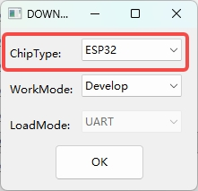
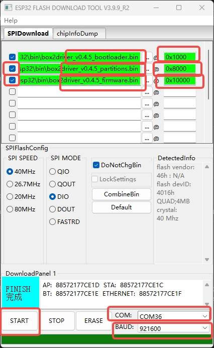
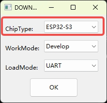
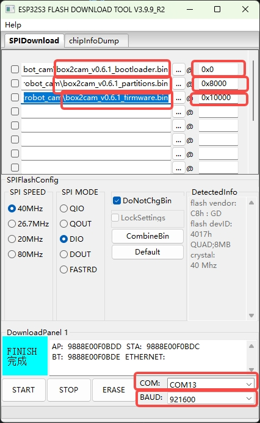
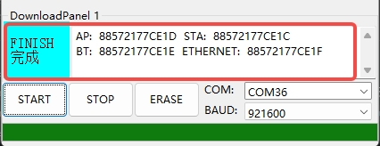

English | [中文](README.md)

# Box2Robot Firmware Flashing Guide

This directory contains pre-built firmware for the Box2Robot Arm Driver Board and Vision-Audio Module, plus a detailed offline flashing guide.

> **Recommended: Online OTA Update**
> If your device is bound to the cloud platform and online, please update via [https://robot.box2ai.com](https://robot.box2ai.com/#/) directly — no manual flashing needed.
> Use this guide only when: flashing a blank board for the first time, the device won't boot, OTA failed and you need to recover, or you want to flash custom-built firmware.

---

## Directory Layout

```
bin/
├── box2robot_arm/                       # Arm Driver Board firmware (ESP32)
│   ├── box2arm_v0.7.0_bootloader.bin
│   ├── box2arm_v0.7.0_partitions.bin
│   ├── box2arm_v0.7.0_firmware.bin
│   └── History/                         # Older versions
├── box2robot_cam/                       # Vision-Audio Module firmware (ESP32-S3)
│   ├── box2cam_v0.6.9_bootloader.bin
│   ├── box2cam_v0.6.9_partitions.bin
│   ├── box2cam_v0.6.9_firmware.bin
│   └── history/                         # Older versions
├── download_driver_CP210x_USB_TO_UART/  # CP210x USB-to-UART driver
└── flash_download_tool_windows/         # Espressif Flash Download Tool (Windows)
    └── flash_download_tool_3.9.9_R2.exe
```

> Current versions: Arm firmware v0.7.0 / Camera firmware v0.6.9. Update each device separately; their images are not interchangeable.

## Release Notes (2026-10-07)

- **ARM v0.7.0**: Independent torque protection for all six joints, a 20 ms check interval (target 50 Hz), and three-sample load filtering. Factory limits for IDs 1–6 are **500 / 600 / 650 / 550 / 450 / 150**; saved configuration can override these defaults. Backdriving reduces torque to yield, then slowly returns to the original target after release. Thermal and stall protection are also included.
- **Telemetry**: ARM fast state frames carry each joint's load, protection limit, protection state, and torque-enable state. Protection transitions immediately send a `servo_protection` event without waiting for a regular state frame. Limits use the servo's raw load units, **not N·m**.
- **CAM v0.6.9**: OTA accepts only trusted HTTPS download URLs, rejects HTTP redirects, and changes the boot partition only after writing and validating the inactive partition. It adds a 30-minute overall timeout, a 60-second no-progress timeout, and failure-reason reporting.
- Both versions are built, packaged, and published for OTA. All six images have been checked for chip compatibility, partition capacity, and matching local/server SHA256; older packages are retained. Public version checks, release notes, and actual application-image download hashes pass verification. Backdrive behavior, real-load protection, and device-side OTA still require physical validation; publishing does not mean devices have already upgraded.

On 2026-10-07, ARM was rebuilt and all three `box2arm_v0.7.0_*.bin` files were replaced in the local package and on the OTA server, with backups retained. CAM is unchanged. The current ARM application image is **1,252,832 bytes**, with SHA256 `09d0ce0bfeca9890313286929f3115be1ff0b8c7659d95b26e31902e5d647fa1`; all three public downloads have been verified. The version remains **0.7.0**, so devices already running 0.7.0 will not discover this replacement through normal version checks; they need reflashing or a separate same-version update workflow. No device upgrade or reboot commands were sent for this replacement.

### OTA vs. Offline Flashing

Normal OTA downloads only the matching device's `firmware.bin`; it does not rewrite the bootloader or partition table, or erase the entire flash. Stop recording, inference, and motion before upgrading, and support the arm to prevent a fall during reboot. Keep power and networking stable.

Initial offline flashing or recovery uses the three files and offsets below. `erase_flash` removes NVS settings such as Wi-Fi, binding, and calibration; use it only for initial flashing or necessary recovery, not as a routine update step.

Release order: synchronize versions → build → copy all three images under versioned names (retain original outputs) → update both language guides → upload and verify SHA256 → back up and update OTA versions and release notes → check the version API and actual downloads → push the update to explicitly identified devices and confirm the result. Keep ARM and CAM versions, images, and release notes separate.

---

## Before You Flash

### 1. Hardware Connection

- During flashing, **connect only the USB-C data cable**.
- **Do NOT connect the DC power line** — dual power sources may cause chip errors.
- Make sure the USB-C cable is a **data cable** (not charge-only — some cheap cables lack data pins).

### 2. Install USB Driver

If your PC doesn't recognize the serial port (no `COMx` in Device Manager), install the CP210x driver:

- **Windows**: Open `bin/download_driver_CP210x_USB_TO_UART/` and run the installer.
- **macOS**: Download the macOS driver from [Silicon Labs](https://www.silabs.com/developers/usb-to-uart-bridge-vcp-drivers).
- **Linux**: The kernel includes `cp210x.ko` by default — no install needed.

### 3. Identify the Serial Port

- **Windows**: *Device Manager* → *Ports (COM & LPT)* → look for `Silicon Labs CP210x USB to UART Bridge (COMx)`
- **macOS**: Run `ls /dev/cu.SLAB_USBtoUART*` or `ls /dev/tty.usbserial*` in Terminal
- **Linux**: Run `ls /dev/ttyUSB*` — usually `/dev/ttyUSB0`

---

## Method 1: esptool CLI (Recommended, Cross-Platform)

esptool is Espressif's official command-line flashing tool, supporting Windows / macOS / Linux.

### 1. Install esptool

```bash
pip install -U esptool
```

### 2. Flash the Arm Driver Board (ESP32)

Erase Flash (only for initial flashing or recovery):

```bash
python -m esptool --chip esp32 erase_flash
```

Write firmware (note: bootloader address is **0x1000**):

```bash
python -m esptool --chip esp32 --baud 921600 write_flash \
  0x1000  bin/box2robot_arm/box2arm_v0.7.0_bootloader.bin \
  0x8000  bin/box2robot_arm/box2arm_v0.7.0_partitions.bin \
  0x10000 bin/box2robot_arm/box2arm_v0.7.0_firmware.bin
```

### 3. Flash the Vision-Audio Module (ESP32-S3)

Erase Flash (only for initial flashing or recovery):

```bash
python -m esptool --chip esp32s3 erase_flash
```

Write firmware (note: bootloader address is **0x0**, different from ESP32):

```bash
python -m esptool --chip esp32s3 --baud 921600 write_flash \
  0x0     bin/box2robot_cam/box2cam_v0.6.9_bootloader.bin \
  0x8000  bin/box2robot_cam/box2cam_v0.6.9_partitions.bin \
  0x10000 bin/box2robot_cam/box2cam_v0.6.9_firmware.bin
```

### 4. Specify Serial Port Manually (Optional)

esptool auto-detects the serial port by default. Use `--port` if multiple devices are connected:

```bash
# Windows
python -m esptool --chip esp32 --port COM5 erase_flash

# macOS
python -m esptool --chip esp32 --port /dev/cu.SLAB_USBtoUART erase_flash

# Linux
python -m esptool --chip esp32 --port /dev/ttyUSB0 erase_flash
```

---

## Method 2: Flash Download Tool (Windows GUI)

If you prefer a GUI, use Espressif's official Flash Download Tool.

Run `bin/flash_download_tool_windows/flash_download_tool_3.9.9_R2.exe`. After launching, select the chip type first.

---

### A. Flash the Arm Driver Board (ESP32)

#### Step 1: Select Chip Type

- ChipType: **ESP32**
- WorkMode: **Develop**
- LoadMode: **UART**

Click **OK** to enter the main interface.

<div align="center">
  
  <p><i>Figure 1 — Select ESP32 for the Arm</i></p>
</div>

#### Step 2: Add 3 bin Files and Set Addresses

Click the `...` button to load each of the 3 bin files, and fill in the **corresponding Flash address**:

| File | Address |
|------|---------|
| `box2arm_v0.7.0_bootloader.bin` | `0x1000` |
| `box2arm_v0.7.0_partitions.bin` | `0x8000` |
| `box2arm_v0.7.0_firmware.bin`   | `0x10000` |

Make sure **all 3 checkboxes are ticked**. Set `COM` port and `BAUD = 921600`, then click **START**:

<div align="center">
  
  <p><i>Figure 2 — Arm bin files and address setup</i></p>
</div>

---

### B. Flash the Vision-Audio Module (ESP32-S3)

#### Step 1: Select Chip Type

- ChipType: **ESP32-S3**
- WorkMode: **Develop**
- LoadMode: **UART**

Click **OK** to enter the main interface.

<div align="center">
  
  <p><i>Figure 3 — Select ESP32-S3 for the Camera</i></p>
</div>

#### Step 2: Add 3 bin Files and Set Addresses

| File | Address |
|------|---------|
| `box2cam_v0.6.9_bootloader.bin` | `0x0` |
| `box2cam_v0.6.9_partitions.bin` | `0x8000` |
| `box2cam_v0.6.9_firmware.bin`   | `0x10000` |

Make sure **all 3 checkboxes are ticked**. Set `COM` port and `BAUD = 921600`, then click **START**:

<div align="center">
  
  <p><i>Figure 4 — Camera bin files and address setup</i></p>
</div>

> ⚠️ **Critical difference**: Arm bootloader is at **`0x1000`**, Camera bootloader is at **`0x0`**. The other two addresses (`0x8000` / `0x10000`) are the same. A wrong address will prevent the device from booting.

---

### C. Wait for FINISH

When the progress bar completes, the status bar at the bottom will turn green and show **FINISH**:

<div align="center">
  
  <p><i>Figure 5 — Flashing successful (FINISH)</i></p>
</div>

After flashing:

1. Close Flash Download Tool (otherwise it keeps the serial port busy)
2. Press the device RESET button, or unplug and replug USB
3. The device boots — Arm OLED lights up / Camera announces status via TTS

---

## Post-Flash Verification

1. **Arm Driver Board**: OLED should light up; if not provisioned, it shows hotspot `Box2Robot_XXXX`.
2. **Vision-Audio Module**: TTS announces current status (hotspot name `Box2Cam_XXXX` or IP address).
3. Connect your phone to the device hotspot — captive portal opens automatically (or visit `192.168.4.1`).
4. Enter your WiFi name and password; the device reboots and connects to your network.
5. The OLED (Arm) or TTS (Camera) will display/announce a 6-digit binding code.
6. Open [https://robot.box2ai.com](https://robot.box2ai.com/#/) and enter the binding code to complete pairing.

---

## Troubleshooting

### Q1: `SerialException` import error

When running esptool you see:

```text
ImportError: cannot import name 'SerialException' from 'serial' (unknown location)
```

This means a wrong `serial` package is installed (it should be `pyserial`). Run:

```bash
python -m pip uninstall -y serial pyserial
python -m pip install -U pyserial esptool
```

Then re-run the flash command.

### Q2: `Failed to connect to ESP32: Timed out waiting for packet header`

esptool can't enter download mode. Check in order:

1. Verify the serial port is correct (use `--port` to specify manually).
2. Check for serial port conflicts (serial monitor, PlatformIO monitor, Arduino Serial Monitor, etc.).
3. Connect only USB during flashing — no DC power.
4. Some boards need manual download mode: hold **BOOT**, tap **RESET**, release **RESET**, then release **BOOT**, then immediately run the flash command.
5. Try a lower baud rate `--baud 115200`.
6. Replace the USB cable (make sure it's a data cable, not charge-only).

### Q3: `Permission denied: '/dev/ttyUSB0'` on Linux

Add your user to the `dialout` group:

```bash
sudo usermod -aG dialout $USER
```

Log out and log back in. Or temporarily run esptool with `sudo`.

### Q4: Flash succeeds but device won't boot / keeps rebooting

1. Verify the bootloader address (**0x1000 for ESP32, 0x0 for ESP32-S3**) — wrong address is the most common cause.
2. All 3 bin files (bootloader / partitions / firmware) must be from the **same version**.
3. Run `erase_flash` first to avoid leftover data conflicts.
4. In Flash Download Tool, all 3 bin checkboxes must be ticked.

### Q5: No TTS sound after flashing the camera

The ESP32-S3 camera takes ~3-5 seconds after power-on before announcing — please wait. If still silent:

- Check the speaker is properly connected.
- Open serial monitor at 115200 baud and look for error logs.
- Re-flash and verify all bin files are intact.

### Q6: Windows can't detect the COM port

1. Install the CP210x driver from `bin/download_driver_CP210x_USB_TO_UART/`.
2. After install, Device Manager should list `Silicon Labs CP210x USB to UART Bridge (COMx)`.
3. If still not detected, try a different USB port or a different USB cable.

---

## Recommended Troubleshooting Order

1. Connect **only the USB-C data cable**, no DC power.
2. Confirm the PC sees the serial port (see "Identify the Serial Port" above).
3. If esptool reports `SerialException`, reinstall dependencies first:

   ```bash
   python -m pip uninstall -y serial pyserial
   python -m pip install -U pyserial esptool
   ```

4. Run `erase_flash` to clear Flash.
5. Run `write_flash` to write firmware (mind the addresses).
6. Press RESET after flashing and check that OLED / TTS comes up correctly.

---

## Links

- **Online OTA Update**: [https://robot.box2ai.com](https://robot.box2ai.com/#/) (recommended)
- **Espressif esptool docs**: [https://docs.espressif.com/projects/esptool/](https://docs.espressif.com/projects/esptool/)
- **CP210x driver download**: [https://www.silabs.com/developers/usb-to-uart-bridge-vcp-drivers](https://www.silabs.com/developers/usb-to-uart-bridge-vcp-drivers)
